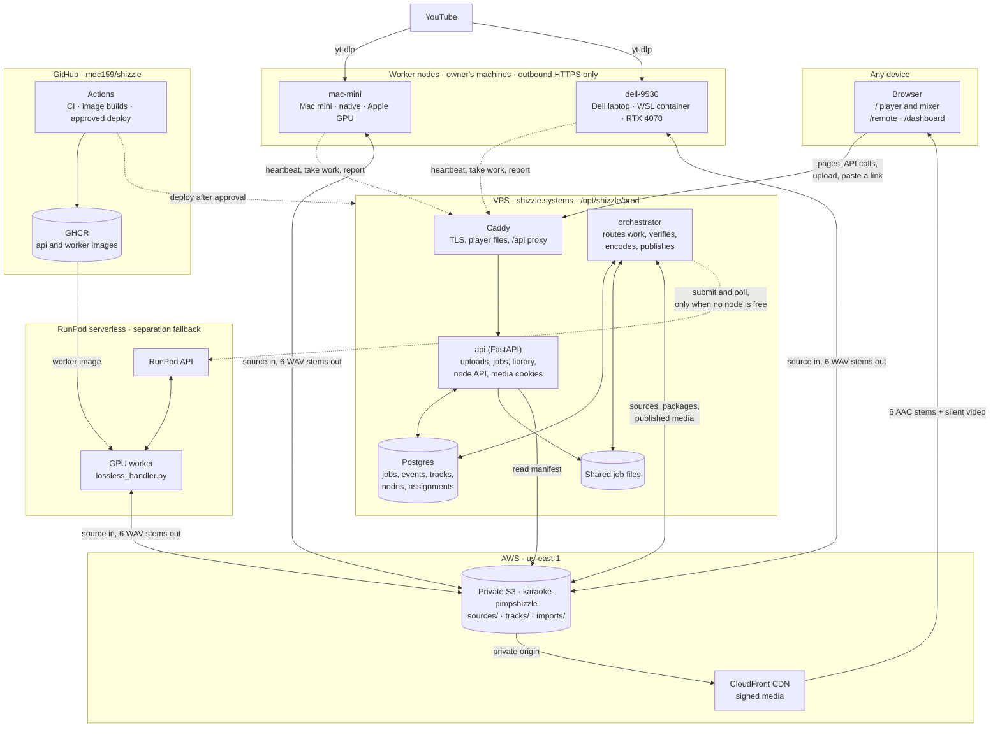
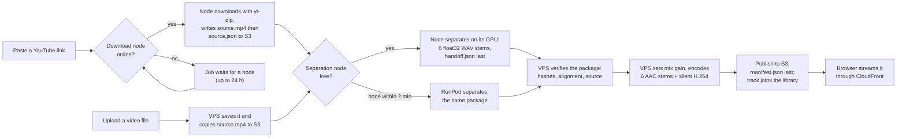

# Shizzle

Shizzle is a cloud karaoke player at <https://shizzle.systems>. Paste a
YouTube link or upload a video, and it is separated into six stems that you
play and mix in the browser: vocals, drums, bass, guitar, piano, and shizzle
(everything else). The owner's own machines, the worker nodes, do the
downloading and GPU separation; RunPod serverless separates when no node is
free. A VPS runs the control plane and turns every separation into browser
media; private S3 stores it and CloudFront delivers it.

## Start here

- [Setup](docs/SETUP.md): prerequisites, local development, configuration, and production commissioning.
- [Worker nodes](docs/WORKER-NODES.md): the Mac mini and Dell nodes, routing, credentials; install in [`node/README.md`](node/README.md).
- [Architecture and swim lanes](docs/architecture.md): components, job transitions, playback, and remote control.
- [Testing](docs/TESTING.md): automated suites, stem-format experiments, listening, and continuous playback/scrubbing checks.
- [Playback troubleshooting](docs/playback-troubleshooting.md): instrumentation and retained experiments.
- [Deployment and rollback](docs/AUTOMATION.md): workflows, approvals, credentials, failure recovery.
- [Review results](docs/REVIEW.md): findings, GitHub issues, validation, and limits.
- [Invariants](docs/INVARIANTS.md): contracts and guarding tests.

## Where everything runs

Solid arrows carry media and files; dotted arrows carry control messages.
Nodes and RunPod never receive inbound connections: nodes poll the API over
HTTPS, and the orchestrator polls RunPod.



| Place | What runs there | Holds |
|---|---|---|
| VPS (`/opt/shizzle/prod`) | Caddy, `api`, `orchestrator`, Postgres, one digest-pinned image for api and orchestrator | the job ledger, the library, node tokens, RunPod and AWS settings (`.env`) |
| Private S3 (`karaoke-pimpshizzle`) | storage only | sources, lossless packages, published generations, drop-box imports |
| CloudFront | the CDN in front of S3 | nothing of its own; serves published media to signed browsers |
| Worker nodes | `shizzle-node` agent: Mac mini natively, Dell 9530 as a container in WSL | a node token and a scoped IAM key each; working files only while a job runs |
| RunPod | serverless GPU worker from `ghcr.io/mdc159/shizzle/worker` | nothing between jobs |
| GitHub | CI, image builds, the approval-gated production deploy | source, images in GHCR |

## How a song becomes a track



- **Download** happens only on a node. The VPS never runs yt-dlp
  (datacenter addresses are blocked), and RunPod cannot download either, so a
  link waits for a node to come online and fails `NO_NODE_AVAILABLE` after 24
  hours. Only single YouTube videos are accepted.
- **Separation** goes to a free node first, for links and uploads alike. If no
  node takes it within two minutes, RunPod runs the same code
  (`stemsplit/lossless_handler.py`) and hands back the same package.
- **Everything after separation happens on the VPS**: verification, the
  shared mix gain, AAC and video encoding, immutable publication, and the
  library row. The first link through production (2026-11-05, a 5:03 song)
  took two minutes on the Mac mini and six on the VPS.
- Completion is always proven by a marker object in S3 (`source.json`,
  `handoff.json`, `manifest.json`, each written last), never by a callback.
  Interrupted work is recovered from those markers and the job ledger.

Three pages share the passcode gate: `/` plays and mixes tracks, `/remote`
controls a playing browser, and `/dashboard` shows job stages, which machine
holds each job, and which nodes are online. Routing is set by
`SHIZZLE_NODE_ROUTING` on the VPS: `prefer` (production), `only` (never
RunPod) or `off` (links fail `YTDLP_BLOCKED`, RunPod separates everything).

## Media contracts

| Boundary | Contract |
|---|---|
| Node or RunPod to VPS | [`lossless-stem-v1`](interfaces/lossless-stem-v1/spec.md): six aligned stereo 44.1 kHz float32 WAV files, hashes and provenance, `handoff.json` last. Separator role `other` becomes `shizzle`. |
| VPS to browser | [`shizzle-browser-v1`](interfaces/shizzle-browser-v1/spec.md): six AAC-LC/M4A stems, audio-less H.264 video, immutable generation, `manifest.json` last. New stems target 256 kb/s at 44.1 kHz; generation average is at most 2.5 Mb/s. |
| Playback | Six independent audio elements feed Web Audio gains and a master compressor. Stems are aligned to the latest-running one with per-stem delays, and the silent video is moved to the stems' audible position. After stem readiness, video is staged into one revocable Blob capped at 128 MiB. |

The lossless intake measures one common attenuation and records it as each
stem's default playback gain; it does not bake that gain into the AAC bytes.
Independent stem normalization changes the mix. Existing compatible AAC may be preserved without
lossy up-transcoding. Artifact checks and listening/playback checks serve
different purposes; both are covered in [Testing](docs/TESTING.md).

A producer that already has a finished `shizzle-browser-v1` package can
skip separation entirely through the
[drop-box](docs/contributing-completed-media.md) under `imports/`.

## Repository map

```text
library/
  src/shizzle_server/
    api/             FastAPI, auth, manifests, node API, WebSocket relay
    db/              Models, leases, jobs, nodes, library and telemetry repositories
    orchestrator/    Source upload, node and RunPod dispatch/poll/recovery, stage loop
    publish/         Lossless intake, delivery profile, audits and publication
  alembic/           Schema migrations (0001 through 0006)
  tests/             Unit and real-Postgres contract tests
node/                Worker-node agent (shizzle-node): download and separate
stemsplit/           Lossless separation code (RunPod image and nodes) and retained reference code
player/              React/TypeScript/Vite UI and Playwright suites
interfaces/          Versioned handoff and browser contracts
deploy/              VPS, RunPod and AWS operations and failure-path tests
ops/                 Audit, migration, metadata and review-sandbox tools
ingest/              Source-acquisition notes
docs/                Current setup, architecture, nodes, testing and operations
docs/archive/        Planning records kept for their reasoning
evidence/            Retained test procedures, scripts and measured results
fixtures/            Synthetic golden-30s.mp4 test source
goals/, templates/   PR review-convergence workflow assets
```

## Development and release

Follow [Setup](docs/SETUP.md#local-api-and-player) for a local API/UI without
cloud jobs. Production ingestion needs cloud configuration and either an
online worker node or a working lossless RunPod endpoint; local/reference and
fault-injection paths do not prove cloud publication.

Run [Testing](docs/TESTING.md). Repository policy requires PRs, the `library`,
`stemsplit`, `player`, and `postgres-contract` checks, and review convergence;
CI also runs a `node` job for the agent, which is not yet a required check.
A deployable master change queues production deployment behind an environment
approval; changes classified as docs-only skip deployment. Worker nodes are
not part of that deploy: each is updated on its own machine
([`node/README.md`](node/README.md)). Old evidence counts are not proof that
the currently deployed build passes.
