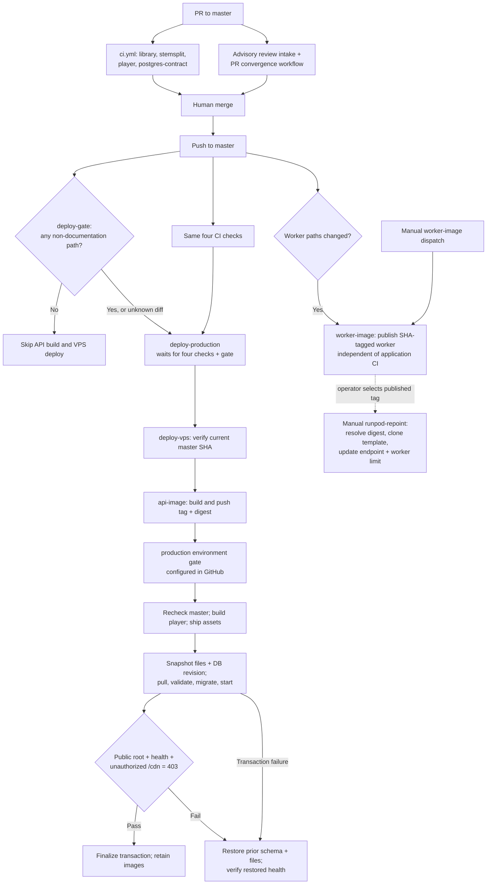

# Shizzle Automation

The review-and-deploy automation package: CI gates, image publishing, gated
VPS deploys, and how the advisory AI reviewers (CodeRabbit, cubic) and the
convergence workflow's own review stay aligned on
[INVARIANTS.md](INVARIANTS.md). This document describes the checked-in workflows under `.github/workflows/`.
GitHub branch rules, environment reviewers, secrets, and live endpoint settings
are configured outside these files and must be verified when bootstrapping.

## 1. System overview



The required check names are `library`, `stemsplit`, `player`, and
`postgres-contract`. AI review output is advisory to branch protection; the
repository's [convergence workflow](../.agents/skills/drive-pr-review-convergence/SKILL.md)
separately determines review readiness and stops before merge.

Only a deployable master push passing all four checks calls `deploy-vps.yml`.
Documentation-only changes still run checks. `worker-image.yml` has its own
path filter (`stemsplit/**` or its workflow file) and manual trigger; it neither
waits for those checks nor updates an endpoint. `runpod-repoint.yml` is
manual-only, uses a registry digest, clones the endpoint's current template,
and sets the new template plus `workers_max` in one endpoint update. The prior
template remains available for explicit rollback. After an ambiguous endpoint
update, the new template is preserved pending reconciliation.

`deploy-staging.yml` is a separate manual-dispatch path (any branch or
commit) onto the staging stack that lives beside production on the same VPS;
see §3b. Only the image and the player bundle come from the chosen ref; the
privileged reusable image builder is pinned to reviewed default-branch
commit `b6cf7129606bb0b903daa709ddf7a7dd3b409d46`, root-executed deploy
assets come from the default branch, and staging deploys run under the
`staging` GitHub environment, whose deployment-branch rule
(default branch only) is a required operator setup step because a dispatch
runs the dispatched ref's copy of the workflow file (§3b). It never touches
the production project or the public site.

## 2. Secrets inventory

| Name | Scope | Grants | Rotation |
|------|-------|--------|----------|
| `VPS_SSH_KEY` | Environment `production` | SSH private key for root on the VPS host; the workflow runs SSH and Compose as root | Generate new keypair, install in `~/.ssh/authorized_keys`, update the secret, remove old pubkey |
| `VPS_HOST` | Environment `production` | Hostname/IP the deploy targets | Update when the box moves |
| `VPS_SSH_HOST_KEY` | Environment `production` | Pinned ed25519 host key so deploy-vps verifies the box (no `StrictHostKeyChecking=no`) | Regenerate with `ssh-keyscan -t ed25519 <host>`; update after any host key change |
| `RUNPOD_API_KEY` | Repo | RunPod API access for `runpod-repoint.yml` (create templates and update endpoints); image publishing uses `GITHUB_TOKEN` | Rotate in the RunPod console, update the repo secret |
| `VPS_STAGING_HOST` | Environment `staging` | Hostname/IP the staging deploy (`deploy-staging.yml`) targets; normally the same VPS as production | Update when the box moves |
| `VPS_STAGING_SSH_KEY` | Environment `staging` | SSH private key for the staging deploy (today root on the shared production host — the same trust level as `VPS_SSH_KEY`, not a lesser one; a dedicated restricted identity is future hardening, see §3b) | Rotate like `VPS_SSH_KEY`, keeping the authorized_keys entry in sync |
| `VPS_STAGING_SSH_HOST_KEY` | Environment `staging` | Pinned ed25519 host key for the staging deploy (same value as `VPS_SSH_HOST_KEY` unless a separate account/host is introduced) | Regenerate with `ssh-keyscan -t ed25519 <host>` |

Runtime secrets (passcode, `POSTGRES_*`, `AWS_*`, CloudFront private key) are
NOT GitHub secrets — they live only in the gitignored `.env` and mounted files
under `/opt/shizzle/prod` per invariant E3. That includes
`SHIZZLE_ADMIN_PROXY_SECRET` (the value Caddy injects as `X-Shizzle-Admin` on
the tailnet-only admin listeners and the api compares on `/api/admin/*`): it
lives in `/opt/shizzle/prod/.env` and `/opt/shizzle/staging/.env`, never in a
workflow, and it is fail-closed — with it unset, every admin route answers
404 on every listener. Both Caddyfiles run `persist_config off` so the
substituted secret is never written to the autosaved config under `/config`;
if a production `autosave.json` predates that setting, remove it once (see
the VPS runbook's admin-listener section). The orchestrator defaults to
`SHIZZLE_PIPELINE=cloud`; with `RUNPOD_API_KEY` and `RUNPOD_ENDPOINT_ID` unset
the stack runs in the valid parked-cloud state — the orchestrator starts and
its service-liveness heartbeat keeps /api/health green, and new jobs fail
closed at dispatch with `RUNPOD_DISPATCH_FAILED`. That heartbeat runs on its
own schedule independent of job processing (B15), so a healthy but long job
stage (source transfer, package verification, AAC/video derivation) cannot
starve it and falsely trip the deploy health gate below. A job already
dispatched to RunPod when
credentials disappear parks instead: its polls fail retryable and the stall
watchdog does not fire while the client is unconfigured, so the live remote
job reconciles on the first poll after credentials return. Set both
variables in the production `.env` when the RunPod path is connected.

The queue-timeout watchdog (`RUNPOD_QUEUE_TIMEOUT_SECONDS`, default 900s)
checks RunPod endpoint health before cancelling a job stuck `IN_QUEUE`: a
worker that is allocated and still pulling its image reports `initializing`,
and the wait extends up to `RUNPOD_COLD_START_SECONDS` (default 1800s)
instead of cancelling and redispatching a fresh worker onto the same endpoint
(invariant B13, hardened after the 2026-09-24 production cold-start
incident). The running-stall watchdog (`RUNPOD_WORKER_STALL_SECONDS`, default
300s) is measured from a heartbeat established on the queued-to-running
transition, never from queue age (invariant B14).

## 3. Deploy procedure

**On merge to master:**

0. The `deploy-gate` job classifies the merge by diffing it against its
   parent. If every changed file is documentation (`docs/`, `evidence/`,
   `goals/`, `.agents/`, or any `*.md`), the deploy chain is skipped —
   nothing a docs-only merge ships would differ, so building an image and
   queuing a production approval is skipped. The gate
   fails open: a missing parent or empty diff deploys.
1. After all four jobs pass on a `master` push, `ci.yml` calls
   `deploy-vps.yml`; pull-request and non-master runs cannot call it. The called
   workflow rechecks the supplied SHA against current `master`. Job
   `build-image` calls reusable `api-image.yml`, which builds and pushes the
   SHA tag and exposes its registry digest.
2. Job `deploy` pauses at the GitHub Environment `production` gate until
   mdc159 approves. The workflow rechecks that `master` still names the same
   reviewed SHA after approval; if `master` advanced while approval was pending,
   the stale run exits cleanly without shipping. While a run waits at the gate
   it still occupies the `ci-refs/heads/master` concurrency group (master runs
   are never cancelled in progress), so GitHub holds at most one further run
   pending behind it and replaces that pending run whenever a newer master
   merge arrives. To ship the newest merge: cancel the run waiting at the gate
   (`gh run cancel <id>`), let the pending run start, and approve that one; it
   carries every earlier merge. Approving the older waiting run first spends an
   approval on a deploy that will stale-skip.
3. After approval, the deploy SSHes to the VPS (using the pinned host key),
   records the prior files and database revision, sets
   `SHIZZLE_API_IMAGE=<tag>@<digest>`, validates the staged Compose config,
   runs `alembic upgrade head` explicitly from the new api image, and starts
   the services. The box receives no source code.

**Health checks after deploy** — the deploy-vps.yml `Check production health`
step asserts, retrying up to 12 times at 10 s intervals until all pass: the
public root request succeeds, `/api/health` passes a jq assertion
(`status=="ok"`, `db==true`, `orchestratorAlive==true`), and `/cdn/tracks/x`
returns exactly 403 (media requires auth). The broader manual verifications
in `deploy/vps/README.md` (telemetry endpoint, CloudFront media Range
behavior) are NOT asserted by the workflow.

**Rollback:**

- Automatic: a deploy or health failure downgrades Alembic to the recorded
  prior revision before restoring the complete prior file snapshot and image
  identity. A real downgrade is mandatory under F1. If the downgrade itself
  fails, rollback still restores the prior files but leaves API and
  orchestrator stopped and returns the original downgrade failure for manual
  recovery; it never starts an old image against an unknown schema state. A
  failed application stop likewise restores the files, skips downgrade and
  restart, and returns the stop failure because schema mutation is unsafe while
  the new application may still be running.
- Break-glass: follow the schema-aware recovery procedure in
  [the VPS runbook](../deploy/vps/README.md). An older image cannot safely start
  until the database revision is compatible with that image. Automated deployment
  refuses an installation with no prior API identity; bootstrap the first
  release explicitly.

**Local-build fallback:** when GHCR is unreachable or for one-off debugging,
the `compose.build.yml` overlay builds the api image on the box from a source
copy instead of pulling the digest-pinned image. Set
`SHIZZLE_API_IMAGE=shizzle-api:local-build`; the overlay points both api and
orchestrator at that one build. It is a fallback, not the
normal path — deploys never ship source to the box.

## 3b. Staging stack and staging deploys

Staging is a full copy of the site running **on the same VPS**, beside
production, so the owner can click through a change before it merges. Layout:
`/opt/shizzle/staging` (own `.env` from `deploy/vps/.env.staging.example`, own
`secrets/cloudfront_private_key.pem`, own `player/`, own named volumes under
the `shizzle-staging` Compose project). Every staging container carries CPU
and memory limits so it cannot starve production, and the only published port
is `127.0.0.1:18080:80` (plain HTTP Caddy). Reachability is tailnet-only via
two host-side `tailscale serve` frontings (§3c).

**Deploying:** run the `deploy-staging` workflow (Actions → deploy-staging →
Run workflow) with a branch or commit SHA — this is how a pull-request branch
gets onto staging before merge. Job split and what it means for trust:

- `resolve` turns the ref into a full SHA; `build-image` reuses
  `mdc159/shizzle/.github/workflows/api-image.yml` pinned to full commit
  `b6cf7129606bb0b903daa709ddf7a7dd3b409d46` from the reviewed default
  branch for the digest-pinned image. A local `./.github/workflows/...` call
  would instead execute the dispatched ref's editable workflow with
  `packages: write` before the protected `deploy` job. Updating the builder
  requires an intentional pin bump. `build-player` builds the player **from
  the chosen ref** in its own job that holds no VPS credentials and uploads
  the bundle as an artifact.
- `deploy` checks out the **default branch** — never the chosen ref — and
  ships `deploy-staging.sh`, `compose.staging.yml`, `Caddyfile.staging` and
  the player artifact over SSH (pinned host key), then runs the transaction
  on the box: pull, `config -q`, `up -d --wait postgres`,
  `alembic upgrade head`, recreate api/orchestrator/caddy, health check on
  `127.0.0.1:18080/api/health`. So the only things a feature branch controls
  are its image contents and its player bundle; the root-executed deploy
  assets come from the reviewed default branch, and a change to
  `deploy-staging.sh`, `compose.staging.yml` or `Caddyfile.staging` reaches
  staging only after it is merged.
- `deploy` uses the GitHub environment **`staging`**, which holds the
  `VPS_STAGING_HOST/SSH_KEY/SSH_HOST_KEY` secrets. REQUIRED (not optional):
  that environment's deployment-branch rule must allow the **default branch
  only** — a manual dispatch executes the *dispatched ref's copy* of the
  workflow file, so without the rule a feature branch could rewrite the
  deploy job and still read the environment's secrets. The workflow's own
  dispatch-ref guard (it fails unless `github.ref` is the default branch)
  is a convenience that points the operator at the right usage; the
  environment rule is the control. Exact commands are in the VPS runbook's
  staging checklist. A required reviewer on the environment is the optional
  stronger setting. The workflow is not callable from `ci.yml`, and its
  script always refuses `/opt/shizzle/prod` (and anything under it) and the
  `shizzle` project, overridable by nothing.

**The boundary that does NOT exist, stated plainly:** the chosen ref's image
still executes on the production VPS host (inside the staging project, with
CPU/memory limits but ordinary Docker isolation), and the staging SSH
identity is **root** on the same box that runs production. Reusing the
production key material is therefore exactly the same trust level as a
production deploy, not a lesser one — it is documented here as a known gap,
not a safety claim. The supported hardening path is a dedicated, restricted
staging SSH identity (and ideally a staging-only Docker context such as a
rootless daemon) so a compromised deploy cannot read `/opt/shizzle/prod/.env`
or touch production volumes; that is future work, and until it exists a
malicious chosen ref running as the staging image can reach the host's
Docker socket-adjacent surface like any container on that box.

**What the workflow itself can never guarantee:** a `workflow_dispatch` run
executes the dispatched ref's copy of the workflow file, so any check living
in `deploy-staging.yml` (including the dispatch-ref guard) is editable by
the very ref being deployed. That is why the `staging` environment's
deployment-branch rule is a required setup step rather than a suggestion:
it is the only component the dispatched ref cannot rewrite.

The first run against a fresh directory (`.env` plus `incoming/` assets)
bootstraps the database — prior `compose.staging.yml`/`Caddyfile`/`player`
can be absent on that first run only, and a failed first deploy stops the
started services and returns the directory to its fresh state.

**Rollback:** staging rollback is deliberately simpler — on any failure the
script first stops the failed services while the failed release's own config
is still active, then restores the prior `.env`/compose/Caddyfile/player. It
restarts the previous image only after an existing release was activated;
pre-activation rollback leaves the untouched running services alone, and a
failed first deploy returns a fresh directory to its fresh state. Stop,
restore and restart failures are surfaced, not swallowed. A failed restore
or restart retains `.staging-rollback.tar.gz`, and either that archive or its
`.tmp` counterpart blocks the next run so no interrupted recovery is
overwritten. The database is never downgraded. An old image may therefore
start against a newer schema on staging; that is acceptable there (redeploy
the newer ref to repair) and is the main way staging rollback differs from
the production transaction in §3.

The health gate requires the normal green `/api/health` response **and** a
row in `orchestrator_heartbeats` whose `worker_id` names the replacement
orchestrator container. The endpoint's latest-row age check alone can stay
green briefly on the previous instance's heartbeat and is not proof that the
replacement survived.

**Data and work isolation:**

- Own Postgres (`shizzle-staging_pgdata`) and job data volume; uploads and
  the library are completely separate from production.
- Own media bucket (`S3_MEDIA_BUCKET` in the staging `.env`). Staging media
  reaches the browser as file-scoped signed CloudFront URLs against a
  *staging* distribution over that bucket (invariant E5) — the arrangement
  that needs no application change. The staging Caddyfile consequently has
  no same-origin `/cdn` proxy; with the CloudFront variables left empty the
  staging site works but tracks cannot play.
- Separation is real on RunPod: the dispatch payload names the staging bucket
  (the worker's `job_input.bucket`), so the endpoint's IAM policy must allow
  that bucket, or staging needs its own endpoint. Staging uploads therefore
  separate normally when `RUNPOD_API_KEY`/`RUNPOD_ENDPOINT_ID` are set in the
  staging `.env`; with them unset the orchestrator still beats (valid
  parked-cloud state) and new jobs fail closed at dispatch.
- `SHIZZLE_NODE_TOKENS` stays empty on staging, so no worker node can ever
  authenticate against it (E6) and the Mac mini and Dell keep serving only
  production. Consequence: **URL jobs cannot complete on staging** — with
  routing `prefer` they wait `NODE_DOWNLOAD_WAIT_SECONDS` (default 86400 s)
  and fail `NO_NODE_AVAILABLE`. Making them work takes a node agent pointed
  at the staging origin (`SHIZZLE_API_BASE=https://shizzle.tailfedd3b.ts.net:8443`,
  a node id/token configured in the staging `.env` only, AWS credentials for
  the staging bucket, and a separate `SHIZZLE_NODE_WORKDIR` if the same
  machine must keep serving production with a second agent instance) — see
  [docs/WORKER-NODES.md](WORKER-NODES.md).

## 3c. Tailscale-only listeners

The VPS already serves HTTPS 443 through `tailscale serve` for another
service (proxy to `127.0.0.1:3773`); the staging and admin listeners use
different ports so it is never disturbed. Real TLS matters because auth
cookies are `Secure`. On the VPS host (once, manually):

```sh
# Staging site: https://shizzle.tailfedd3b.ts.net:8443
tailscale serve --bg --https=8443 http://127.0.0.1:18080
# Admin listener for production (and its /admin page): https://shizzle.tailfedd3b.ts.net:8444
tailscale serve --bg --https=8444 http://127.0.0.1:18081
```

To undo either fronting (staging maintenance, rollback to no-admin):

```sh
tailscale serve --https=8443 off
tailscale serve --https=8444 off
```

Both loopback ports are published by Compose with an explicit `127.0.0.1`
host IP (`compose.staging.yml`, `compose.prod.yml`), so nothing is reachable
off-box except through the tailnet TLS terminators.

## 4. Reviewer alignment

Active reviewers consume the same source of truth:
[INVARIANTS.md](INVARIANTS.md).

- **CodeRabbit** — configured by [`.coderabbit.yaml`](../.coderabbit.yaml):
  `path_instructions` mirror the invariant series per area, and the
  `knowledge_base.code_guidelines` block makes CodeRabbit ingest
  `docs/INVARIANTS.md` directly, so reviews cite invariant IDs ("violates B3").
- **Greptile (retired)**: Greptile is retired for this project. Do not trigger it, request credentials, wait for its completion, or use its score/status as a readiness blocker. Independently validate any historical findings that still apply.
- **cubic** — configured through its dashboard custom rules. The seven paste
  texts below are the standalone versions of the same path instructions; the
  owner pastes each into the dashboard.

### Coordinated review policy

- CodeRabbit is a free-plan advisory intake reviewer. It reviews the initial PR
  when quota is available; automatic incremental review is disabled. Never wait
  for quota or require a final-head CodeRabbit run.
- Cubic is advisory. Consume available P0/P1 findings, but do not wait for its
  completion or restart the loop for P2 polish.
- The workflow performs an independent whole-diff review of the final candidate
  after required CI. No Greptile review, score, or approval gates readiness.
  Require zero reproduced P0/P1 findings, no required human finding, and
  evidence-backed dispositions for every finding.
- Allow at most two repair batches. If a reproduced P0/P1 remains after the
  confirmation review, stop for human adjudication instead of greplooping.
- Reviewer findings are deduplicated into one ledger and fixed in batches. The
  coordinator owns readiness; reviewers provide evidence and never command one
  another.

## 5. cubic paste-text

One block per path scope; paste each into cubic's dashboard custom rules.

```text
Scope: stemsplit/**
RunPod GPU worker for the lossless-stem-v1 interface. Enforce handoff-last
ordering (A1): handoff.json must be uploaded only after every stem PUT has
returned — flag any code path that writes or renames it earlier. Every dispatch
attempt must write beneath its own immutable attempts/<sha256(idempotency_key)>
prefix (A6); older workers must never clobber newer receipts. Check S3
atomicity assumptions (A1, A10): every upload carries a locally computed
sha256, and the shared progress callback closure is mutated by several
transfer-manager threads, so every read-modify-write must hold its lock and
progress must stay monotonic (A11). Stems must stay pcm_f32le stereo 44100
with identical sample counts and no per-stem normalization (A3). The
flat-module layout (lossless_worker.py, s3_ops.py, etc. as siblings, no
package structure) is intentional for the worker image — do not suggest
packaging or directory reorganization.
```

```text
Scope: library/src/shizzle_server/orchestrator/**
Durable orchestrator stage loop. Enforce the B-series invariants from
docs/INVARIANTS.md: lease ownership must be checked inside the locked
transaction (B2), and the dispatch reservation must commit before any external
RunPod call (B3) — a timeout or 5xx must never trigger a second dispatch; it
reconciles the outstanding reservation instead. Poll-failure events dedupe to
one row per outage and any other event resets the window (B6). A failed RunPod
cancel must never mask the original error — _cancel_best_effort logs and
swallows (B7). Park frees the lease without consuming an attempt or appending
an event (B9). Every unresolvable error path fails closed (B5, B10) and every
stage handler must be idempotent under crash-rerun (B11). Heartbeats are
written only on phase change (B8); a RunPod job already marked failed
dispatches fresh under a new idempotency key (B12). A queue timeout consults
endpoint health and waits out a cold start (initializing workers) up to the
cold-start budget before cancelling (B13), and the queued-to-running
transition establishes a fresh running heartbeat before any stall check (B14).
The service liveness heartbeat runs on its own task, independent of job
processing, and a failed write leaves it stale rather than faking it (B15).
```

<!-- Mirrored copy: duplicates the library/src/shizzle_server/db/repository.py
     path instruction in .coderabbit.yaml — edit both together. -->
```text
Scope: library/src/shizzle_server/db/repository.py
Postgres data layer for the orchestrator and publisher. Enforce the
data-layer invariants from docs/INVARIANTS.md: job claims use
SELECT ... FOR UPDATE SKIP LOCKED and reclaiming an expired foreign lease
records a lease_reclaimed event in the same transaction (B1); lease
ownership must be verified under row lock (with_for_update) inside the same
transaction as every lease-scoped write (B2); the dispatch reservation must
be committed by its own transaction before any caller performs the external
API call, and duplicate reservations must be blocked (B3); confirmation
deliberately requires no lease — key it on the latest reservation so a stale
dispatcher cannot overwrite a newer one (B4); legacy dispatch_unconfirmed
state must fail closed, blocking redispatch rather than paying twice (B5);
worker heartbeats are written only on phase change (B8); park frees the
lease without consuming an attempt or appending an event (B9). Publish
writes are idempotent: track ids are deterministic uuid5 so crash-reruns
converge on one row (C4), and generation activation is a compare-and-swap
under with_for_update with the ledger event committed in the same
transaction (C5). Job events are append-only and ordered — no UPDATE or
DELETE on the events table (F5).
```

```text
Scope: library/src/shizzle_server/publish/**
Publication and delivery-profile policy. Enforce the C and D series from
docs/INVARIANTS.md: the manifest is the completion marker and is written last,
via server-side copy only (C2); published generations are immutable — an
existing destination manifest makes the publish a no-op (C1); the format guard
(m4a stems, 64 MiB cap, no raw PCM) must run before any promotion (C3); track
ids are deterministic uuid5 so reruns converge (C4); generation activation is
compare-and-swap with the ledger event in the same transaction (C5).
Duration/bitrate gates must reference the named constants in
delivery_profile.py (TRACK_DURATION_TOLERANCE_SEC 0.100,
STEM_DURATION_TOLERANCE_SEC 0.080, STEM_INTER_DURATION_TOLERANCE_SEC 0.005,
2.5 Mb/s cap) — flag any magic number or locally redefined tolerance (D1-D4).
delivery_profile.py must stay a pure policy module with no boto3/ffmpeg/db
imports (D7); at most one common attenuation, never per-stem and never a
boost (D3).
```

```text
Scope: library/alembic/**
Database migrations. Enforce the F series from docs/INVARIANTS.md: a single
linear chain with numeric filename prefix equal to the revision id and an
explicit down_revision (F1); additive-only changes unless the author
explicitly signs off on a destructive or rewriting migration — if you see a
drop/rewrite, ask for that sign-off in review. Every upgrade needs a paired,
real (non no-op) downgrade (F1). The DSN comes from DATABASE_URL and
target_metadata is Base.metadata (F2). Only the explicit production deploy
transaction migrates the production database from the api image after recording
the rollback revision (F3); long-running api and orchestrator services never
migrate. Isolated contract databases may run alembic upgrade head. The migration
itself is under test via the contract suite's real `alembic upgrade head`
subprocess (F4) — flag any test fixture that uses create_all.
```

```text
Scope: .github/workflows/**
CI/CD workflows. Build tags must be sha-pinned and deployments must use the
registry digest; flag latest/vN tags, tag-only deploys, or hand-pushed images.
Every workflow needs least-privilege permissions and a concurrency group. No
secret echoing or StrictHostKeyChecking=no. deploy-vps admits only the current
master SHA after successful push CI, rechecks it after the production approval
gate, and must roll back both files and the database revision on failure.
```

```text
Scope: player/**
Browser player. Light review: correctness and obvious accessibility issues
only. No styling bikeshed — do not comment on CSS preferences, formatting, or
component organization. Flag real bugs (state races, broken playback logic,
unhandled errors) and clear WCAG violations (missing labels, keyboard traps,
contrast only when egregious).
```

## 6. Verification and remaining coverage limits

The `library` CI job runs both shell failure-path suites with stubbed Docker,
registry, and RunPod calls. The required `postgres-contract` job uses a real
Postgres service, applies Alembic migrations, exercises concurrency/crash
contracts, and downgrades the head migration by one revision before upgrading
again. The `player` job builds, lints, and runs only the mocked browser specs
listed in its Playwright test step in
[ci.yml](../.github/workflows/ci.yml). These checks do not replace the
[real playback tests](playback-troubleshooting.md) or prove live deployment
rollback against a real Docker stack.

Current checked-in limits:

- `mypy src` in the library job is informational (`continue-on-error: true`).
- CI jobs run on the pinned `ubuntu-24.04` image and `stemsplit` pins its
  interpreter to 3.11 (the worker image's Python). The `ubuntu-latest` label
  moved to 26.04 / Python 3.14 on 2026-11-05 and broke both the stemsplit
  tests (numpy 1.26.4 built from source) and the Playwright install;
  retiring the pin needs both checked again.
- Player `knip` is configured but not run in CI.
- The player check installs Chromium from the Playwright browser CDN on each
  run; that dependency can block CI during an outage.
- CPU worker tests mock separation; the image's offline weights check proves
  model availability, not successful GPU separation or runtime egress policy.
- RunPod repoint tests mock the API, so live template/endpoint API behavior
  requires a separate authorized validation.
- `deploy/vps/tests/test_staging_stack.sh` (staging transaction and rollback
  fault injection, replacement-heartbeat gate, compose publication/limits,
  reserved-character PostgreSQL authentication, Caddy admin routing) runs in
  the `library` job beside
  the release-transaction suite. Its stubbed parts run anywhere; its
  Docker-gated parts (compose config JSON, `caddy validate`, live
  admin-routing probes over stub upstreams and a disposable PostgreSQL
  authentication check) execute only where a Docker daemon answers, which
  includes the CI runners.
- The worker-image workflow lacks a concurrency group and uses version-tagged
  Actions, unlike the SHA-pinned application image/deploy workflows.
- See [INVARIANTS.md](INVARIANTS.md) for explicitly unguarded contracts.

## 7. Installation prerequisites

Set up these external dependencies before the first automated deployment:

1. Create and configure the GitHub `production` environment and its required
   reviewer before allowing deployment runs. Referencing an environment in
   YAML does not itself configure an approval requirement.
2. Add the three VPS environment secrets from §2, plus the repository RunPod
   secret when endpoint updates are needed. The CI caller currently passes
   `secrets: inherit` to the deploy workflow.
3. Make the GHCR API/worker packages readable by their target hosts: public
   packages or explicit read credentials. A successful Actions push does not
   prove that an anonymous VPS or RunPod pull succeeds.
4. Bootstrap the VPS files, mounted secrets, external Caddy volume, database
   revision, and first active image as described in
   [deploy/vps/README.md](../deploy/vps/README.md). Automated deployment requires
   a real prior release to restore.
5. Configure branch protection around the actual four CI check names and the
   repository's PR policy. Configure the advisory reviewers using §4–5.
6. Configure and independently verify the RunPod endpoint using
   [deploy/runpod/README.md](../deploy/runpod/README.md). Image publication and
   endpoint activation are separate operations.
7. Bring up staging when wanted: create the staging S3 bucket + CloudFront
   distribution and key group (file-scoped signed URLs, E5), prepare
   `/opt/shizzle/staging` from `deploy/vps/.env.staging.example`, create the
   `staging` GitHub environment, **set its deployment-branch rule to the
   default branch only** (required — see §3b), add the three `VPS_STAGING_*`
   environment secrets there, run the two `tailscale serve` commands in §3c,
   then dispatch `deploy-staging`. The full ordered checklist lives in
   [deploy/vps/README.md](../deploy/vps/README.md#staging-stack).
