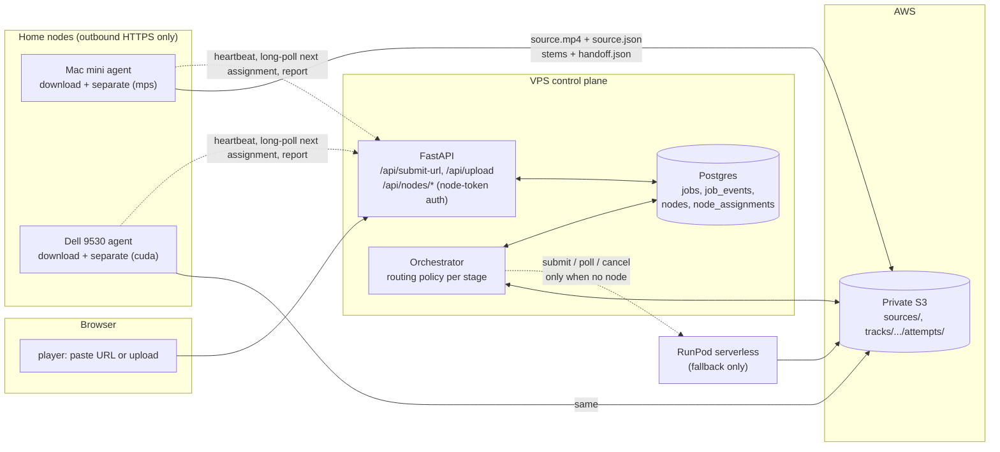

# Worker nodes: Mac mini and Dell 9530 as first-choice executors

Written 2026-11-05 against master `0415ed2`, decisions recorded the same
day. This is a plan, not a record of implemented behavior. Nothing in it has
been started. It replaces the
uncommitted `docs/NODE_ROUTING_PLAN.md` referenced from the next-phase
draft (PR #62) and is written to be executed phase by phase through the
normal PR workflow.

## Open question 2026-11-05: which container runs on the Dell

Owner, 2026-11-05: "For creating the files, we've got that nailed down. We
shouldn't change anything. We put a lot of work into optimizing the
multi-track file." Later: "The 6 should be named shizzle.m4a, not other."

This plan assumes the Dell runs the production lossless worker image
(`ghcr.io/mdc159/shizzle/worker`, `stemsplit/Dockerfile.lossless`), which is
what RunPod runs today. Under that assumption nothing about file creation
changes: the node emits the lossless package (six WAVs, the sixth named
`stems/shizzle.wav`) and the VPS derives the browser files, with the sixth AAC
stem named `stems/shizzle.m4a`, exactly as it does for a browser upload now.

Two facts do not fit that assumption and are unresolved from this session:

- The web path has never produced `multi-track.mp4` (open issue #29 is that
  the website's Download Multi-Track button cannot succeed for cloud
  uploads). The only code in the four reviewed repos that writes
  `multi-track.mp4` is the retired all-in-one worker in
  `mdc159/shizzle-worker`, which also names the sixth stem `other.m4a` and
  encodes stems at 320 kb/s.
- The owner reports a local container that downloads, splits and writes the
  optimized multi-track file, with the sixth stem named `shizzle.m4a`. That
  combination matches no code in the reviewed repos.

Until the Dell's image is identified (`docker images`, `docker ps -a`, or a
Remote Control session), the node design stays as written below. If the Dell
runs a newer all-in-one container that emits finished browser media, the
handoff would move to the drop-box (`imports/{source_ref}/`, invariant C8),
which requires a complete `shizzle-browser-v1` package (every v3 manifest
field, not just `delivery_profile` and `integrity.objects`), and the 2.5 Mb/s
budget (D4) would have to be measured on one real package first. That path is
not implemented; the Mac inventory found no such container. If it runs the production worker
image, the plan applies unchanged and a multi-track archive file is an
optional add-on step on the node, assembled from finished stems without
re-encoding.

## Status 2026-11-05: Phases 1–3 implemented, awaiting the first live run

Implemented on this branch (see the PR for the commits):

- `library/`: migration `0006_worker_nodes`, `NodeRepository`, `/api/nodes`
  routes, orchestrator routing in `orchestrator/nodes.py` (download via node,
  separation node-first with RunPod fallback, stall/expire/redispatch),
  `jobs.executor`, invariants A12, B16, B17, E6 with their tests.
- `stemsplit/lossless_handler.py`: `handler(job, progress=...)` and an explicit
  `device` so a node runs the production separation code unchanged.
- `node/`: the agent (`shizzle-node`), with its README covering the Mac mini
  install (native `mps`), the Dell (CUDA), the VPS `.env` and the IAM policy.
- `player/`: URL input in Add Source, node-aware progress, nodes strip on
  `/dashboard`.

Not yet done, against the plan's own done criteria below:

- a live run (one URL through shizzle.systems with the Mac online), and the
  matching run with the agents stopped (RunPod fallback), both recorded under
  `evidence/`;
- the IAM user for the node, `SHIZZLE_NODE_TOKENS` in the production `.env`,
  and the Mac's launchd service;
- the Mac inventory written up under `evidence/` (it was taken on 2026-11-05
  over the bridge session and is summarized in "Node runtime: as built", but
  the raw listing is not yet committed);
- the Mac CPU-in-container versus native-MPS measurement. It was **not**
  taken: the inventory showed no separator container on the Mac and Docker
  Desktop cannot reach the Apple GPU, so native MPS was chosen without the
  measurement. That is a decision taken against the container-first
  runtime section of the plan, recorded in "Decisions taken" below;
- the Dell agent install (Mac first by the owner's decision).

The Phase sections further down are the original plan and are kept as the
done criteria; "Node runtime: as built" is the authoritative description of
what runs.

## Goal

The owner, 2026-11-05:

> "Have the cloud version working and using the Mac Mini and the Dell 9530
> as worker nodes. If I wanted to drop a URL in there, it checks to see from
> the web if there's a worker node available and uses one of those devices
> to download. If that node is also capable of doing the stem splitting, it
> does that as well to take the load off the serverless. The serverless only
> operates when there is no node available."

Restated as rules the orchestrator will enforce:

1. The web app at <https://shizzle.systems> stays the one control plane:
   one catalog, one job ledger, one publication path, one set of gates.
2. A URL job is downloaded by an online node. The VPS never runs yt-dlp
   (datacenter addresses are blocked; that is why `YTDLP_BLOCKED` exists).
   If no download-capable node is online, the job waits for one.
3. Separation goes to an online, idle, separation-capable node first.
   RunPod is used only when no such node answers within a short window.
4. Nodes hand off exactly what RunPod hands off today: a `lossless-stem-v1`
   package under the job's attempt prefix, `handoff.json` last. The VPS
   verifies, derives browser media and publishes exactly as it does now.
   Nothing after the interface changes.
5. A node that goes away mid-job is treated like a dead RunPod worker: the
   attempt fails, the job redispatches under a fresh key, and the next
   executor may be another node or RunPod (invariant B12).

## What exists today and what is reused

| Need | Exists | Where | Reuse |
|---|---|---|---|
| URL job creation | yes, unused by the UI | `POST /api/submit-url` in `library/src/shizzle_server/api/routes.py` | keep; wire the player to it |
| URL download | yes, Mac only, not integrated | `ingest/` on `cbassist/m-shizzle` branch `codex/mac-youtube-ingest`: a Docker image with yt-dlp, ffprobe, sha256, local queue | the node's download container, used as is |
| Separation image | yes, in production | `ghcr.io/mdc159/shizzle/worker` from `stemsplit/Dockerfile.lossless`, already has `--local` mode | the node's separation container, same image RunPod pulls |
| Attempt claim, receipt heartbeat, handoff-last, post-write verification | yes, RunPod-bound | `stemsplit/lossless_handler.py` `handler()` | extract into an executor module both RunPod and nodes call |
| Mac GPU separation proof | yes | `evidence/spikes/mac-stem-separation/` on the Mac fork: 255.9 s track separated in 18.2 s on `mps:0` | evidence that rule 3 is worth doing |
| Dispatch reservation, confirmation, reconciliation, stall watchdogs | yes, RunPod-bound | `orchestrator/stages.py` `handle_dispatched`, `db/repository.py` `reserve_dispatch`/`confirm_dispatch`, `orchestrator/cloud.py` receipts | generalize the executor; keep the bookkeeping |
| Package verification and publication | yes | `orchestrator/cloud.py` `cloud_verifying`/`cloud_publishing`, `publish/` | unchanged |
| Service liveness heartbeat row | yes | `OrchestratorHeartbeat`, `/api/health` | pattern for node heartbeats |
| Pipeline dashboard | yes | `PipelinePanel` on `/dashboard` | add a nodes panel |

Not reused for this purpose:

- The Mac fork's native Swift player and PR #50 (authenticated finished-media
  import). Those make the Mac a *producer of finished browser packages*. This
  plan makes the Mac and Dell *executors inside the existing pipeline*, which
  keeps one delivery transform and one set of D-gates on the VPS. The
  drop-box (`docs/contributing-completed-media.md`) remains for ad-hoc
  contributions; PR #50 should be parked or closed once this lands.
- `mdc159/shizzle-worker` (retired spike) and `1215-Labs/shizzle-mac` (a
  stale copy of this repo at `3fe9d78`). Neither carries node code.

## Architecture



Design choices and why:

- **Nodes pull; the VPS never connects to a node.** Both machines sit behind
  home NAT. Outbound HTTPS to the existing API is the only path that needs
  no Tailscale, no port forwarding, and works when a machine wakes up late.
  This is the same conclusion the Mac fork's
  `docs/mac-youtube-ingest-plan.md` reached for the link inbox.
- **Completion is proven in S3, reported over the API.** The node writes
  `source.json` after `source.mp4` and `handoff.json` after the stems, then
  tells the API. The orchestrator treats the S3 marker as truth and the API
  report as a hint, exactly as it treats `dispatch.json`/`handoff.json` for
  RunPod today (A1, B10). A lost report changes latency, not correctness.
- **Nodes authenticate with their own tokens, not the shared passcode.** The
  passcode gate is intentionally open (owner decision 2026-09-03). Node
  endpoints require a per-node bearer token that grants nothing on the
  library or playback routes.
- **Nodes produce `lossless-stem-v1`, not browser media.** The VPS keeps the
  delivery transform, the D-gates and publication. A node-produced package
  is indistinguishable to `cloud_verifying` except for
  `separation.worker_image`, which records the node agent and device
  (schema: free string, so `node:mac-mini/agent-0.1/mps` is valid).

## Data model

Migration `0006_worker_nodes` (next in the single linear chain, F1):

```text
nodes
  id                 text pk           ("mac-mini", "dell-9530")
  display_name       text
  (no token column: tokens live only in SHIZZLE_NODE_TOKENS on the VPS, E6)
  capabilities       jsonb             {"download": true, "separate": true,
                                        "device": "mps", "max_duration_s": 1800}
  agent_version      text
  last_seen_at       timestamptz
  busy_assignment_id uuid null
  disabled_at        timestamptz null  (operator kill switch)

node_assignments
  id                 uuid pk
  job_id             uuid fk jobs
  node_id            text fk nodes
  kind               text              "download" | "separate"
  idempotency_key    text              (separate: the job's dispatch key)
  status             text              assigned | acknowledged | running |
                                        completed | failed | expired
  heartbeat_at       timestamptz
  phase              text              last progress string
  detail             jsonb             sha256, bytes, error, timings
  created_at / updated_at
```

`jobs` gains `executor text null` (`runpod` or `node:<id>`) so the dashboard
and recovery code know who holds the current attempt. `job_events` gains new
event names, no schema change: `node_assigned`, `node_acknowledged`,
`node_progress`, `node_completed`, `node_failed`, `node_wait`,
`fallback_runpod`.

## Node API

All routes require a node token, and the token must be the one configured
for the `{id}` in the path; an assignment can be acknowledged, progressed,
completed or failed only by the node it names (E6). Responses never include
credentials. The job's `source_ref` (the URL, always one YouTube video) is
delivered here and nowhere else; the public job API still never exposes it
(E2).

| Route | Purpose |
|---|---|
| `POST /api/nodes/{id}/heartbeat` | body: capabilities, agent version, busy assignment, free disk. Updates `last_seen_at`. Every 15 s. |
| `GET /api/nodes/{id}/assignments/next?wait=25` | long-poll. Returns at most one assignment the orchestrator created for this node, or 204. |
| `POST /api/nodes/assignments/{aid}/ack` | node has started; sets `acknowledged`. |
| `POST /api/nodes/assignments/{aid}/progress` | phase string, mirrors RunPod progress updates; dedup on change only (B8). |
| `POST /api/nodes/assignments/{aid}/complete` | download: `{sha256, bytes, duration_s, source_json_key}`; separate: `{package_prefix}`. Orchestrator re-proves against S3. |
| `POST /api/nodes/assignments/{aid}/fail` | structured error code, bounded detail. |

Operator and dashboard reads (passcode-gated, existing auth):
`GET /api/nodes` lists nodes with online/busy state; `/dashboard` shows it.

## Routing policy in the orchestrator

A node is **online** when `last_seen_at` is younger than
`NODE_ONLINE_SECONDS` (default 45) and `disabled_at` is null. It is
**available** for a kind when it is online, advertises that capability,
and `busy_assignment_id` is null. Selection among several available nodes:
the one least recently heard from (`updated_at`, a stable spread rather than a strict round-robin), ties by name.

### downloading stage

```text
upload job   -> as today: upload_source() to S3, advance to dispatched
url job      -> SHIZZLE_NODE_ROUTING = off  -> fail YTDLP_BLOCKED (old behavior)
                not a single YouTube video   -> fail YTDLP_BLOCKED (nodes fetch
                                                nothing else; checked at submit too)
                if a download assignment exists for this job:
                  source.json present in S3 and re-proven against source.mp4
                  (object key, sha256, size)  -> record input_checksum, advance
                      to dispatched; the node's API report is a hint, the
                      marker completes the assignment even if the report was lost
                  assignment heartbeat older than NODE_STALL_SECONDS
                      -> mark assignment failed, node_failed event, fall through
                  otherwise park (recheck NODE_POLL_SECONDS)
                else if an available download node exists
                  -> create assignment, node_assigned event, park
                else
                  -> node_wait event (once per outage), park;
                     after NODE_DOWNLOAD_WAIT_SECONDS (default 24 h)
                     fail NO_NODE_AVAILABLE, non-retryable
```

The 24-hour default is deliberate: the owner's own plan accepts a link
while the Mac is asleep and downloads when it wakes. There is no RunPod
fallback for download because RunPod cannot download either.

### dispatched stage

```text
if job.executor startswith "node:"  -> poll that node assignment:
     handoff.json present under the attempt prefix -> verifying (as today;
                                                      the marker, not the report)
     assignment failed or heartbeat stale          -> fail attempt, redispatch
                                                      fresh key (B12)
     otherwise park
elif job.executor == "runpod"       -> existing RunPod branch, unchanged
else (no executor yet):
     SHIZZLE_NODE_ROUTING = off     -> existing RunPod dispatch, no node lookup
     available separate node that has not already expired/failed this job
                                    -> create assignment with key, reserve and
                                       confirm executor = node:<assignment>, park
     no node ever registered        -> RunPod at once (prefer)
     no node, waited < NODE_SEPARATE_WAIT_SECONDS (default 120)
                                    -> node_wait event, park
     no node, routing = prefer, RunPod configured
                                    -> fallback_runpod event, existing dispatch
     no node, routing = only, or RunPod unconfigured
                                    -> keep waiting for a node (never RunPod)
```

Policy knobs in `settings.py`, all env-driven:

| Setting | Default | Meaning |
|---|---|---|
| `SHIZZLE_NODE_ROUTING` | `prefer` | `prefer` (nodes first, RunPod fallback), `only` (never RunPod), `off` (today's behavior) |
| `NODE_ONLINE_SECONDS` | 45 | heartbeat age that still counts as online |
| `NODE_STALL_SECONDS` | 300 | assignment heartbeat age that fails the attempt (mirrors `RUNPOD_WORKER_STALL_SECONDS`) |
| `NODE_SEPARATE_WAIT_SECONDS` | 120 | how long to hold a separation for a node before RunPod |
| `NODE_DOWNLOAD_WAIT_SECONDS` | 86400 | how long a URL job waits for any download node |
| `NODE_POLL_SECONDS` | 10 | park interval while an assignment runs |

With `SHIZZLE_NODE_ROUTING=prefer` and the RunPod endpoint's `workers_max`
left as it is, rule 3 holds: RunPod spends money only when no node answers
within two minutes. Setting `only` makes RunPod a manual choice.

### Same node, download then separate

When the node that downloaded a URL job is also separation-capable, the
`dispatched` stage prefers it (affinity through `detail.source_cached_on`),
and the node skips the S3 source download when the local file's sha256
matches the assignment. This is an optimization, not a correctness
requirement: the S3 copy is always the source of record, and
`cloud_verifying` still checks `source.object_key` and `source.sha256`
against the job.

## Node runtime: as built

The 2026-11-05 decision favoured containers, and the Mac inventory the same
evening showed what the Mac actually runs: the downloader container
(`shizzle-ingest:local`, stopped for six weeks) and **native** separation on
the Apple GPU through the proof script. There is no separator container on
the Mac, and Docker Desktop cannot reach the Apple GPU. The agent was
therefore built as one native Python service, `node/` (`shizzle-node`):

| Piece | How | Notes |
|---|---|---|
| agent loop | `uv run --directory node shizzle-node` | heartbeat thread, long-poll, one assignment at a time |
| download | yt-dlp in-process, `allowed_extractors: ["youtube"]`, ffprobe gate | refuses anything that is not one YouTube video; writes `source.mp4` then `source.json` with conditional PUTs (first writer wins, never overwritten) |
| separate | imports `../stemsplit/lossless_handler.py` and calls `handler(job, progress=...)` | the production code RunPod runs, `device=mps` on the Mac, `cuda` on the Dell; package and writes unchanged |

No Docker socket is mounted anywhere; the agent holds only the node token and
the node's scoped AWS keys. The containers decision stands for the Dell if a
CUDA container is preferred there, but nothing in the design depends on it.

### Inventory (done 2026-11-05)

The Mac's only Shizzle image is the downloader; separation is native. The
retired combined worker (`ghcr.io/mdc159/shizzle-worker:v2`, k25 lineage)
was not found on the Mac. The Dell has not been inventoried.

### GPU access per machine

- **Dell 9530 (Windows, RTX 4070):** the agent runs natively with the CUDA
  torch build (README); a CUDA container is an alternative, not a need.
- **Mac mini (M4 Pro):** native `mps` (proof: 18.2 s for a 4:16 track).

### Credentials on a node

Phase 1 ships with a per-node IAM user. `s3:HeadObject` is not an IAM action
(HEAD is authorized by `s3:GetObject`), and without `s3:ListBucket` a missing
key answers 403 instead of 404, which the worker's `_is_not_found` would treat
as an error; so the policy is:

```json
{
  "Version": "2012-10-17",
  "Statement": [
    {
      "Effect": "Allow",
      "Action": ["s3:PutObject", "s3:GetObject"],
      "Resource": [
        "arn:aws:s3:::karaoke-pimpshizzle/sources/*",
        "arn:aws:s3:::karaoke-pimpshizzle/tracks/*/1/separation/attempts/*"
      ]
    },
    {
      "Effect": "Allow",
      "Action": "s3:ListBucket",
      "Resource": "arn:aws:s3:::karaoke-pimpshizzle",
      "Condition": {"StringLike": {"s3:prefix": ["sources/*", "tracks/*/1/separation/attempts/*"]}}
    }
  ]
}
```

Accepted risk, stated plainly: this static policy lets a node read and write
every job's source and separation attempt, not only its own assignment's. The
nodes are the owner's own machines, so this is accepted for Phase 1; the
overwrite hazard is closed separately by conditional writes (a stale node
cannot replace an accepted `source.mp4`, `source.json`, `dispatch.json` or
`handoff.json`). Per-assignment STS credentials, which PR #50 argued for,
remain the Phase 4 follow-up. Keys come from the Studio54 vault, never from a
`.env` in a checkout (E3). Nodes never hold RunPod, CloudFront, database or
deploy credentials.

## Player and dashboard

- `AddSourceModal.tsx` gains a URL field that calls `POST /api/submit-url`
  (title and artist optional). The job card shows the executor and phase:
  "waiting for a node", "downloading on mac-mini 40%", "separating on
  dell-9530", "separating on RunPod".
- `/dashboard` gains a nodes strip: name, online, device, busy job, last
  seen. It polls `GET /api/nodes` on the same five-second cadence as jobs.
- Failure copy for `NO_NODE_AVAILABLE`: "No download node was online within
  24 hours. Start the Mac mini or Dell agent and resubmit."

## Invariants to add (same PR as the code they guard)

- **A12 source.json is written last.** A node-downloaded source is complete
  only when `sources/<track>/source.json` exists and its sha256 matches the
  object; the orchestrator never dispatches separation on `source.mp4` alone.
- **B16 node assignments are fenced like dispatches.** An assignment is
  created only inside the lease, after `reserve_dispatch` for separation;
  a stale node cannot complete an assignment the orchestrator has failed.
- **B17 RunPod is the fallback, not the default.** With routing `prefer`,
  the orchestrator emits `fallback_runpod` only after `node_wait` has aged
  past `NODE_SEPARATE_WAIT_SECONDS`; the test asserts no RunPod dispatch
  occurs while an available node exists.
- **E6 node tokens are node-scoped.** A node token is rejected on every
  non-`/api/nodes/*` route; the public job API never returns `source_ref`.

## Phases (original plan, kept as the done criteria)

Where this section says "container", the as-built agent runs natively (see
"Node runtime: as built" and "Decisions taken"). Each phase is one or two PRs through the required `library`, `stemsplit`,
`player` and `postgres-contract` checks and the review-convergence workflow.
Each adds its tests, invariants and docs in the same PR. Production deploys
through the human-approved gate as usual.

### Phase 0: housekeeping (no deploy)

- Confirm which image the RunPod endpoint runs; the worker workflow says
  the legacy `ghcr.io/mdc159/shizzle-worker:v2` may still be pulled. Repoint
  to `ghcr.io/mdc159/shizzle/worker:sha-...` and archive
  `mdc159/shizzle-worker`.
- Decide `1215-Labs/shizzle-mac`: delete or make it a mirror. It carries no
  unique work.
- Delete the thirteen merged `fix/*`, `codex/*`, `feat/*`, `docs/currency-*`
  branches.
- Park PR #50 with a comment pointing at this document.

### Phase 1: node registry and heartbeat

Migration 0006, `nodes` and `node_assignments`, node-token auth, heartbeat
and list routes, dashboard strip, agent image that registers and beats from
the Mac mini. Inventory the containers already on the Mac and the Dell
(image, digest, output format). No routing yet. Done when the Mac shows
online on `/dashboard`, a bad token is rejected (E6 test), and the inventory
is recorded under `evidence/`.

### Phase 2: URL download through a node

`downloading` stage routing, download assignment flow, `source.json`
marker, agent runs the ingest container per assignment, player URL field.
RunPod still separates.
Done when a YouTube URL pasted into the web app plays as a published track
with the Mac doing the download and RunPod doing the split, and the job
events show `node_assigned`, `node_completed`, `runpod_dispatched`. This
phase alone makes "drop a URL" work.

### Phase 3: separation on a node, RunPod as fallback

`stemsplit/attempt.py` refactor and `--assignment` mode in the worker
image, agent runs the worker container per assignment, `dispatched` stage
routing with `NODE_SEPARATE_WAIT_SECONDS`, stall and reclaim,
`fallback_runpod` event, B16/B17 tests. Measure Mac CPU-in-container
separation and decide native MPS or container. Install the Dell agent
(CUDA in Docker Desktop/WSL2). Done when the same URL job completes with
zero RunPod calls while a node is online, and completes through RunPod when
the agents are stopped. Record both runs under `evidence/`.

### Phase 4: polish

Source-cache affinity, concurrency (one job per node today; a node may
advertise `slots`), node-side disk and image-digest checks in the
heartbeat, STS credentials per assignment, and optionally moving the delivery transform onto nodes if the
VPS's 4 vCPU ffmpeg step becomes the ceiling (next-phase draft measured it
at three to four parallel songs).

## Decisions taken 2026-11-05

Asked and answered by the owner on 2026-11-05:

| Question | Decision |
|---|---|
| Dell from day one? | **Mac mini first, Dell later.** Install order only; the code is the same. |
| RunPod `workers_max` during rollout | **Leave it as is.** `SHIZZLE_NODE_ROUTING=prefer` keeps RunPod idle while a node is online. |
| Do uploads also prefer a node? | **Yes.** Rule 3 is about load, not source type. Upload jobs go to S3 as today, then a node separates if one is online. |
| Mac fork and PR #50 | **Nodes run the existing containers; no code copy required.** Images are the interface: the production worker image for separation, the fork's ingest image for download. PR #50's import API is not the node path and stays parked. |
| Mac runtime (2026-11-05, evening) | **Native `mps`, not a container.** The plan's runtime section was container-first; the Mac inventory found no separator container and Docker Desktop cannot reach the Apple GPU, so the measurement the plan asked for was not taken and the agent runs the production handler natively. Revisit only if a GPU-capable container runtime appears on macOS. |
