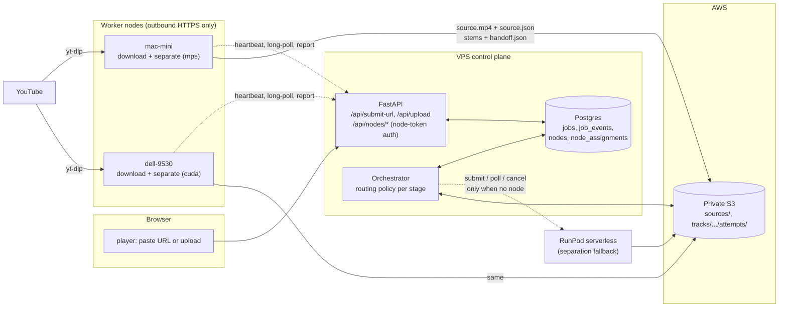

# Worker nodes

Worker nodes are the owner's own machines doing the GPU-side work for
<https://shizzle.systems>: downloading a pasted YouTube link and separating
stems. RunPod serverless is the fallback for separation. The VPS remains the
one control plane: it holds the job ledger, verifies every package, derives
the browser media and publishes. Nodes produce exactly what RunPod produces,
a [`lossless-stem-v1`](../interfaces/lossless-stem-v1/spec.md) package.

The agent is `node/` (`shizzle-node`); install and operation are in
[`node/README.md`](../node/README.md). The planning record, including the
owner's decisions, is archived in
[worker-nodes-plan-2026-11-05](archive/worker-nodes-plan-2026-11-05.md).

## The nodes

| Node id | Machine | Runtime | GPU | Kept running by | Logs |
|---|---|---|---|---|---|
| `mac-mini` | Mac mini (M4 Pro), tailnet `cbass` | native Python, checkout `~/Projects/shizzle`, `uv run` | Apple `mps` | launchd `com.shizzle.node` | `/tmp/shizzle-node.log` |
| `dell-9530` | Dell 9530 laptop (Windows 11, RTX 4070 8 GB) | Docker container `shizzle-node` in WSL Ubuntu-24.04, image built on the production worker image | CUDA | container `--restart unless-stopped`; Windows logon task "WSL keepalive (shizzle node, firecrawl)" holds WSL open | `docker logs shizzle-node` |

Both run master's `node/` and `stemsplit/lossless_handler.py`, the same
separation code RunPod runs. Both advertise `download` and `separate` and
take one assignment at a time. A node that is asleep or switched off is
simply offline; jobs route around it.

Measured on 2026-11-05 with a 5:03 track: download and merge took 13.7 s on
the Mac and 4.7 s on the Dell; separation took 27.7 s on the Mac (`mps`) and
12.4 s on the Dell (CUDA). The first URL job through production, job
`94a95b30`, ran end to end in eight minutes with no RunPod involvement:
download and separation on `mac-mini` took two minutes, upload of the six
WAVs included, and the VPS's verification, encoding and publication took the
other six.

## Rules the orchestrator enforces

1. A URL job is downloaded by an online node. The VPS never runs yt-dlp
   (datacenter addresses are blocked). With no download-capable node online
   the job waits, up to 24 hours by default, then fails
   `NO_NODE_AVAILABLE`. RunPod cannot download, so there is no fallback for
   this step.
2. Separation, for URL and uploaded jobs alike, goes to an online, idle,
   separation-capable node first. RunPod is used only when no node takes it
   within two minutes (`prefer`), or never (`only`).
3. Completion is proven in S3 (`source.json`, `handoff.json`) and only
   reported over the API. The orchestrator treats the S3 marker as truth,
   exactly as it does for RunPod (A1, B10).
4. A node that goes away mid-job is treated like a dead RunPod worker: the
   attempt fails, the job redispatches under a fresh key, and the next
   executor may be another node or RunPod (B12, B16).
5. Everything after the lossless package is unchanged: the VPS verifies,
   measures gain, encodes AAC and video, publishes and activates.

## Architecture



Design choices and why:

- **Nodes pull; the VPS never connects to a node.** Both machines sit behind
  home NAT. Outbound HTTPS to the API needs no Tailscale, no port forwarding,
  and works when a machine wakes up late.
- **Nodes authenticate with their own tokens, not the shared passcode.** The
  passcode gate is intentionally open (owner decision 2026-09-03). Node
  routes require a per-node bearer token that grants nothing on the library
  or playback routes (E6).
- **Nodes produce `lossless-stem-v1`, not browser media.** The VPS keeps the
  delivery transform, the D-gates and publication. A node package differs
  from a RunPod one only in `separation.worker_image`, which records the
  node agent and device.

## Data model

Migration `0006_worker_nodes`:

```text
nodes
  id                 text pk           ("mac-mini", "dell-9530")
  display_name       text
  (no token column: tokens live only in SHIZZLE_NODE_TOKENS on the VPS, E6)
  capabilities       jsonb             {"download": true, "separate": true,
                                        "device": "mps", "agent": "shizzle-node/0.1.0"}
  agent_version      text
  last_seen_at       timestamptz
  busy_assignment_id uuid null
  disabled_at        timestamptz null  (operator kill switch)

node_assignments
  id                 uuid pk
  job_id             uuid fk jobs
  node_id            text fk nodes
  kind               text              "download" | "separate"
  idempotency_key    text              (separate: the job's dispatch key)
  status             text              assigned | acknowledged | running |
                                        completed | failed | expired
  heartbeat_at       timestamptz
  phase              text              last progress string
  detail             jsonb             sha256, bytes, error, timings
  created_at / updated_at
```

A node row is created on its first authenticated heartbeat. `jobs.executor`
(`runpod` or `node:<id>`) records who holds the current attempt. Job events
add `node_assigned`, `node_acknowledged`, `node_progress`, `node_completed`,
`node_failed`, `node_wait` and `fallback_runpod`.

Separation on a node reuses the dispatch reservation, so its events keep
their historical names: `runpod_dispatch_started` and `runpod_dispatched`
appear for node jobs too. `runpod_job_id` of `node:<assignment id>` marks a
node; only a bare RunPod job id means RunPod ran.

## Node API

Every node route requires the bearer token configured for the `{node_id}`
in the path, and an assignment can be acknowledged, progressed, completed or
failed only by the node it names (E6). Responses never include credentials.
The job's `source_ref` (the URL) is delivered here and nowhere else (E2).

| Route | Purpose |
|---|---|
| `POST /api/nodes/{node_id}/heartbeat` | display name, capabilities, agent version, busy assignment. Updates `last_seen_at`. Every 15 s. |
| `GET /api/nodes/{node_id}/assignments/next?wait=25` | long-poll; at most one assignment for this node, or 204. |
| `POST /api/nodes/{node_id}/assignments/{aid}/ack` | the node has started. |
| `POST /api/nodes/{node_id}/assignments/{aid}/progress` | phase string, deduplicated on change (B8). A 409 tells the node the assignment is no longer its own. |
| `POST /api/nodes/{node_id}/assignments/{aid}/complete` | download: sha256, bytes, duration, title; separate: package prefix. The orchestrator re-proves against S3. |
| `POST /api/nodes/{node_id}/assignments/{aid}/fail` | structured error code and bounded detail. |

`GET /api/nodes` (passcode auth, like the rest of the app) lists nodes with
online and busy state for `/dashboard`.

## Routing policy in the orchestrator

A node is **online** when `last_seen_at` is younger than
`NODE_ONLINE_SECONDS` (45) and `disabled_at` is null. It is **available**
for a kind when it is online, advertises that capability, and
`busy_assignment_id` is null. Among several available nodes the one least
recently updated is chosen, ties by name.

### downloading stage

```text
upload job   -> upload_source() to S3, advance to dispatched
url job      -> SHIZZLE_NODE_ROUTING = off  -> fail YTDLP_BLOCKED
                not a single YouTube video   -> fail YTDLP_BLOCKED (refused at
                                                submit too)
                if a download assignment exists for this job:
                  source.json present in S3 and re-proven against source.mp4
                  (object key, sha256, size)  -> record input_checksum, advance
                      to dispatched; the marker completes the assignment even
                      if the node's report was lost
                  assignment heartbeat older than NODE_STALL_SECONDS
                      -> mark assignment failed, node_failed event, fall through
                  otherwise park (recheck NODE_POLL_SECONDS)
                else if an available download node exists
                  -> create assignment, node_assigned event, park
                else
                  -> node_wait event (once per outage), park;
                     after NODE_DOWNLOAD_WAIT_SECONDS (24 h)
                     fail NO_NODE_AVAILABLE, non-retryable
```

### dispatched stage

```text
if job.executor startswith "node:"  -> poll that node assignment:
     handoff.json present under the attempt prefix -> verifying
     assignment failed or heartbeat stale          -> fail attempt, redispatch
                                                      fresh key (B12)
     otherwise park
elif job.executor == "runpod"       -> RunPod branch
else (no executor yet):
     SHIZZLE_NODE_ROUTING = off     -> RunPod dispatch, no node lookup
     available separate node that has not already expired/failed this job
                                    -> create assignment with key, reserve and
                                       confirm executor = node:<assignment>, park
     no node ever registered        -> RunPod at once (prefer)
     no node, waited < NODE_SEPARATE_WAIT_SECONDS
                                    -> node_wait event, park
     no node, routing = prefer, RunPod configured
                                    -> fallback_runpod event, RunPod dispatch
     no node, routing = only, or RunPod unconfigured
                                    -> keep waiting for a node (never RunPod)
```

A node deletes its working files when each assignment ends, so a separation
always reads the source back from S3, even on the node that downloaded it.

| Setting | Default | Meaning |
|---|---|---|
| `SHIZZLE_NODE_ROUTING` | `prefer` | `prefer` (nodes first, RunPod fallback), `only` (never RunPod), `off` (URL jobs fail, RunPod separates) |
| `SHIZZLE_NODE_TOKENS` | empty | `mac-mini=<token>,dell-9530=<token>`; production sets both |
| `NODE_ONLINE_SECONDS` | 45 | heartbeat age that still counts as online |
| `NODE_ACK_SECONDS` | 120 | an assignment not acknowledged in this window expires |
| `NODE_STALL_SECONDS` | 300 | assignment heartbeat age that fails the attempt |
| `NODE_ASSIGNMENT_MAX_SECONDS` | 10800 | absolute cap on one assignment (B16) |
| `NODE_SEPARATE_WAIT_SECONDS` | 120 | how long a separation waits for a node before RunPod |
| `NODE_DOWNLOAD_WAIT_SECONDS` | 86400 | how long a URL job waits for any download node |
| `NODE_POLL_SECONDS` | 10 | park interval while an assignment runs |

Production runs `prefer` with RunPod's `workers_max` unchanged, so RunPod
spends money only when no node answers within two minutes.

## Credentials

- **Node token:** one per node, generated on the VPS, stored in the
  production `.env` (`SHIZZLE_NODE_TOKENS`) and in that node's env file.
  Nothing else holds it.
- **AWS:** one IAM user per node, `shizzle-node-mac-mini` and
  `shizzle-node-dell-9530`, each with the inline policy `shizzle-node-s3`
  below and one access key that lives only in that node's env file.

```json
{
  "Version": "2012-10-17",
  "Statement": [
    {
      "Effect": "Allow",
      "Action": ["s3:PutObject", "s3:GetObject"],
      "Resource": [
        "arn:aws:s3:::karaoke-pimpshizzle/sources/*",
        "arn:aws:s3:::karaoke-pimpshizzle/tracks/*/1/separation/attempts/*"
      ]
    },
    {
      "Effect": "Allow",
      "Action": "s3:ListBucket",
      "Resource": "arn:aws:s3:::karaoke-pimpshizzle",
      "Condition": {"StringLike": {"s3:prefix": ["sources/*", "tracks/*/1/separation/attempts/*"]}}
    }
  ]
}
```

HEAD is authorized by `s3:GetObject`; `s3:ListBucket` on those prefixes
makes a missing key answer 404 rather than 403, which the "is it there yet"
checks rely on. Accepted risk: the policy covers every job's source and
attempt prefix, not only the current assignment's. The nodes are the owner's
machines; conditional writes (first writer wins) stop a stale node from
replacing an accepted `source.mp4`, `source.json`, `dispatch.json` or
`handoff.json`. Nodes never hold RunPod, CloudFront, database or deploy
credentials.

## Player and dashboard

- Add Source has a URL field that calls `POST /api/submit-url`. The job card
  shows the executor and phase: "Fetching source", "Separating on mac-mini",
  "Separating on RunPod".
- `/dashboard` has a nodes strip (name, online, device, busy job, last seen)
  and shows each job's executor.
- `NO_NODE_AVAILABLE` reads "No download node was online within the wait
  window. Start the node agent and try again."

## Invariants

A12 (a node-downloaded source is complete only with `source.json`), B16
(node assignments are fenced like dispatches), B17 (RunPod is the fallback,
not the default) and E6 (node tokens are node-scoped) are in
[Invariants](INVARIANTS.md) with their guarding tests.

## Open items

- Evidence: the first live URL run and a run with both agents stopped
  (proving the RunPod fallback) are not yet recorded under `evidence/`.
- Mac disk: the Mac mini's data volume is about 99% full (6.5 GiB free on
  2026-11-05). A job's working files are deleted when it ends, but a long
  video's source plus six float32 WAVs needs several GiB at its peak.
- The Dell's GPU is shared with other local containers (ComfyUI, Ollama);
  running them during a separation can exhaust its 8 GB.
- Phase 4 ideas from the plan remain unbuilt: per-assignment STS
  credentials, more than one job per node, disk and image-digest reporting in
  the heartbeat, and moving the delivery transform onto nodes.
