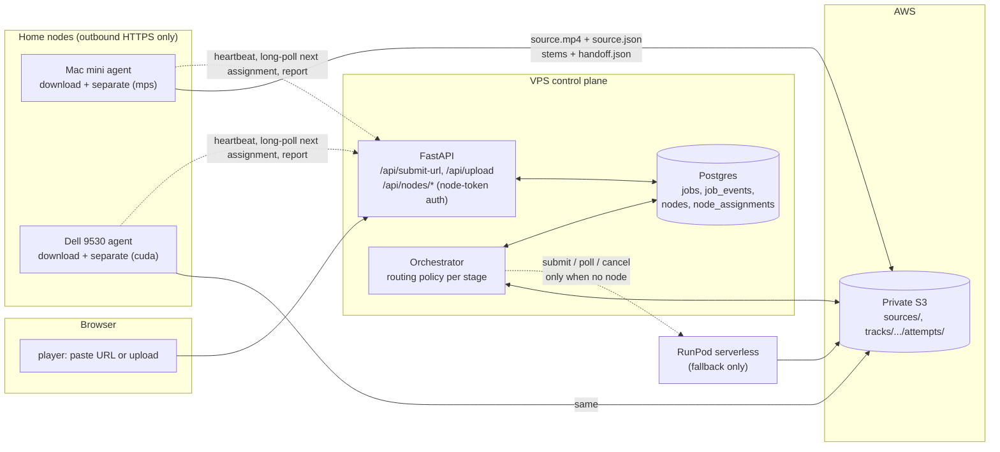

# Worker nodes: Mac mini and Dell 9530 as first-choice executors

Written 2026-11-05 against master `0415ed2`, decisions recorded the same
day. This is a plan, not a record of implemented behavior. Nothing in it has
been started. It replaces the
uncommitted `docs/NODE_ROUTING_PLAN.md` referenced from the next-phase
draft (PR #62) and is written to be executed phase by phase through the
normal PR workflow.

## Open question 2026-11-05: which container runs on the Dell

Owner, 2026-11-05: "For creating the files, we've got that nailed down. We
shouldn't change anything. We put a lot of work into optimizing the
multi-track file." Later: "The 6 should be named shizzle.m4a, not other."

This plan assumes the Dell runs the production lossless worker image
(`ghcr.io/mdc159/shizzle/worker`, `stemsplit/Dockerfile.lossless`), which is
what RunPod runs today. Under that assumption nothing about file creation
changes: the node emits the lossless package and the VPS derives the browser
files, with the sixth stem named `shizzle.m4a`, exactly as it does for a
browser upload now.

Two facts do not fit that assumption and are unresolved from this session:

- The web path has never produced `multi-track.mp4` (open issue #29 is that
  the website's Download Multi-Track button cannot succeed for cloud
  uploads). The only code in the four reviewed repos that writes
  `multi-track.mp4` is the retired all-in-one worker in
  `mdc159/shizzle-worker`, which also names the sixth stem `other.m4a` and
  encodes stems at 320 kb/s.
- The owner reports a local container that downloads, splits and writes the
  optimized multi-track file, with the sixth stem named `shizzle.m4a`. That
  combination matches no code in the reviewed repos.

Until the Dell's image is identified (`docker images`, `docker ps -a`, or a
Remote Control session), the node design stays as written below. If the Dell
runs a newer all-in-one container that emits finished browser media, the
handoff moves to the drop-box (`imports/{source_ref}/`, invariant C8), the
agent adds only the two manifest fields that contract requires
(`delivery_profile`, `integrity.objects`), and the 2.5 Mb/s budget (D4) must
be measured on one real package first. If it runs the production worker
image, the plan applies unchanged and a multi-track archive file is an
optional add-on step on the node, assembled from finished stems without
re-encoding.

## Status 2026-11-05: Phases 1–3 implemented, awaiting the first live run

Implemented on this branch (see the PR for the commits):

- `library/`: migration `0006_worker_nodes`, `NodeRepository`, `/api/nodes`
  routes, orchestrator routing in `orchestrator/nodes.py` (download via node,
  separation node-first with RunPod fallback, stall/expire/redispatch),
  `jobs.executor`, invariants A12, B16, B17, E6 with their tests.
- `stemsplit/lossless_handler.py`: `handler(job, progress=...)` and an explicit
  `device` so a node runs the production separation code unchanged.
- `node/`: the agent (`shizzle-node`), with its README covering the Mac mini
  install (native `mps`), the Dell (CUDA), the VPS `.env` and the IAM policy.
- `player/`: URL input in Add Source, node-aware progress, nodes strip on
  `/dashboard`.

Not yet done: a live run (one URL through shizzle.systems with the Mac online),
the IAM user for the node, `SHIZZLE_NODE_TOKENS` in the production `.env`,
and the Mac's launchd service. The Mac inventory (2026-11-05) showed no
separator container there: separation runs natively on the Apple GPU, which
is what the agent does; the downloader container stays as is for the native
app and is not used by the agent.

## Goal

The owner, 2026-11-05:

> "Have the cloud version working and using the Mac Mini and the Dell 9530
> as worker nodes. If I wanted to drop a URL in there, it checks to see from
> the web if there's a worker node available and uses one of those devices
> to download. If that node is also capable of doing the stem splitting, it
> does that as well to take the load off the serverless. The serverless only
> operates when there is no node available."

Restated as rules the orchestrator will enforce:

1. The web app at <https://shizzle.systems> stays the one control plane:
   one catalog, one job ledger, one publication path, one set of gates.
2. A URL job is downloaded by an online node. The VPS never runs yt-dlp
   (datacenter addresses are blocked; that is why `YTDLP_BLOCKED` exists).
   If no download-capable node is online, the job waits for one.
3. Separation goes to an online, idle, separation-capable node first.
   RunPod is used only when no such node answers within a short window.
4. Nodes hand off exactly what RunPod hands off today: a `lossless-stem-v1`
   package under the job's attempt prefix, `handoff.json` last. The VPS
   verifies, derives browser media and publishes exactly as it does now.
   Nothing after the interface changes.
5. A node that goes away mid-job is treated like a dead RunPod worker: the
   attempt fails, the job redispatches under a fresh key, and the next
   executor may be another node or RunPod (invariant B12).

## What exists today and what is reused

| Need | Exists | Where | Reuse |
|---|---|---|---|
| URL job creation | yes, unused by the UI | `POST /api/submit-url` in `library/src/shizzle_server/api/routes.py` | keep; wire the player to it |
| URL download | yes, Mac only, not integrated | `ingest/` on `cbassist/m-shizzle` branch `codex/mac-youtube-ingest`: a Docker image with yt-dlp, ffprobe, sha256, local queue | the node's download container, used as is |
| Separation image | yes, in production | `ghcr.io/mdc159/shizzle/worker` from `stemsplit/Dockerfile.lossless`, already has `--local` mode | the node's separation container, same image RunPod pulls |
| Attempt claim, receipt heartbeat, handoff-last, post-write verification | yes, RunPod-bound | `stemsplit/lossless_handler.py` `handler()` | extract into an executor module both RunPod and nodes call |
| Mac GPU separation proof | yes | `evidence/spikes/mac-stem-separation/` on the Mac fork: 255.9 s track separated in 18.2 s on `mps:0` | evidence that rule 3 is worth doing |
| Dispatch reservation, confirmation, reconciliation, stall watchdogs | yes, RunPod-bound | `orchestrator/stages.py` `handle_dispatched`, `db/repository.py` `reserve_dispatch`/`confirm_dispatch`, `orchestrator/cloud.py` receipts | generalize the executor; keep the bookkeeping |
| Package verification and publication | yes | `orchestrator/cloud.py` `cloud_verifying`/`cloud_publishing`, `publish/` | unchanged |
| Service liveness heartbeat row | yes | `OrchestratorHeartbeat`, `/api/health` | pattern for node heartbeats |
| Pipeline dashboard | yes | `PipelinePanel` on `/dashboard` | add a nodes panel |

Not reused for this purpose:

- The Mac fork's native Swift player and PR #50 (authenticated finished-media
  import). Those make the Mac a *producer of finished browser packages*. This
  plan makes the Mac and Dell *executors inside the existing pipeline*, which
  keeps one delivery transform and one set of D-gates on the VPS. The
  drop-box (`docs/contributing-completed-media.md`) remains for ad-hoc
  contributions; PR #50 should be parked or closed once this lands.
- `mdc159/shizzle-worker` (retired spike) and `1215-Labs/shizzle-mac` (a
  stale copy of this repo at `3fe9d78`). Neither carries node code.

## Architecture



Design choices and why:

- **Nodes pull; the VPS never connects to a node.** Both machines sit behind
  home NAT. Outbound HTTPS to the existing API is the only path that needs
  no Tailscale, no port forwarding, and works when a machine wakes up late.
  This is the same conclusion the Mac fork's
  `docs/mac-youtube-ingest-plan.md` reached for the link inbox.
- **Completion is proven in S3, reported over the API.** The node writes
  `source.json` after `source.mp4` and `handoff.json` after the stems, then
  tells the API. The orchestrator treats the S3 marker as truth and the API
  report as a hint, exactly as it treats `dispatch.json`/`handoff.json` for
  RunPod today (A1, B10). A lost report changes latency, not correctness.
- **Nodes authenticate with their own tokens, not the shared passcode.** The
  passcode gate is intentionally open (owner decision 2026-09-03). Node
  endpoints require a per-node bearer token that grants nothing on the
  library or playback routes.
- **Nodes produce `lossless-stem-v1`, not browser media.** The VPS keeps the
  delivery transform, the D-gates and publication. A node-produced package
  is indistinguishable to `cloud_verifying` except for
  `separation.worker_image`, which records the node agent and device
  (schema: free string, so `node:mac-mini/agent-0.1/mps` is valid).

## Data model

Migration `0006_worker_nodes` (next in the single linear chain, F1):

```text
nodes
  id                 text pk           ("mac-mini", "dell-9530")
  display_name       text
  token_sha256       text              (bearer token hash; raw never stored, E3)
  capabilities       jsonb             {"download": true, "separate": true,
                                        "device": "mps", "max_duration_s": 1800}
  agent_version      text
  last_seen_at       timestamptz
  busy_assignment_id uuid null
  disabled_at        timestamptz null  (operator kill switch)

node_assignments
  id                 uuid pk
  job_id             uuid fk jobs
  node_id            text fk nodes
  kind               text              "download" | "separate"
  idempotency_key    text              (separate: the job's dispatch key)
  status             text              assigned | acknowledged | running |
                                        completed | failed | expired
  heartbeat_at       timestamptz
  phase              text              last progress string
  detail             jsonb             sha256, bytes, error, timings
  created_at / updated_at
```

`jobs` gains `executor text null` (`runpod` or `node:<id>`) so the dashboard
and recovery code know who holds the current attempt. `job_events` gains new
event names, no schema change: `node_assigned`, `node_acknowledged`,
`node_progress`, `node_completed`, `node_failed`, `node_wait`,
`fallback_runpod`.

## Node API

All routes require a node token. Responses never include credentials. The
job's `source_ref` (the URL) is delivered here and nowhere else; the public
job API still never exposes it (E2).

| Route | Purpose |
|---|---|
| `POST /api/nodes/{id}/heartbeat` | body: capabilities, agent version, busy assignment, free disk. Updates `last_seen_at`. Every 15 s. |
| `GET /api/nodes/{id}/assignments/next?wait=25` | long-poll. Returns at most one assignment the orchestrator created for this node, or 204. |
| `POST /api/nodes/assignments/{aid}/ack` | node has started; sets `acknowledged`. |
| `POST /api/nodes/assignments/{aid}/progress` | phase string, mirrors RunPod progress updates; dedup on change only (B8). |
| `POST /api/nodes/assignments/{aid}/complete` | download: `{sha256, bytes, duration_s, source_json_key}`; separate: `{package_prefix}`. Orchestrator re-proves against S3. |
| `POST /api/nodes/assignments/{aid}/fail` | structured error code, bounded detail. |

Operator and dashboard reads (passcode-gated, existing auth):
`GET /api/nodes` lists nodes with online/busy state; `/dashboard` shows it.

## Routing policy in the orchestrator

A node is **online** when `last_seen_at` is younger than
`NODE_ONLINE_SECONDS` (default 45) and `disabled_at` is null. It is
**available** for a kind when it is online, advertises that capability,
and `busy_assignment_id` is null. Selection among several available nodes:
the one with the oldest `busy` release (round robin), ties by name.

### downloading stage

```text
upload job   -> as today: upload_source() to S3, advance to dispatched
url job      -> if a download assignment exists for this job:
                  source.json present in S3 and sha256 matches the report
                      -> record input_checksum, advance to dispatched
                  assignment heartbeat older than NODE_STALL_SECONDS
                      -> mark assignment failed, node_failed event, fall through
                  otherwise park (recheck NODE_POLL_SECONDS)
                else if an available download node exists
                  -> create assignment, node_assigned event, park
                else
                  -> node_wait event (once per outage), park;
                     after NODE_DOWNLOAD_WAIT_SECONDS (default 24 h)
                     fail NO_NODE_AVAILABLE, non-retryable
```

The 24-hour default is deliberate: the owner's own plan accepts a link
while the Mac is asleep and downloads when it wakes. There is no RunPod
fallback for download because RunPod cannot download either.

### dispatched stage

```text
if job.executor startswith "node:"  -> poll that node assignment:
     handoff.json present under the attempt prefix -> verifying (as today)
     assignment failed or heartbeat stale          -> fail attempt, redispatch
                                                      fresh key (B12)
     otherwise park
elif job.executor == "runpod"       -> existing RunPod branch, unchanged
else (no executor yet):
     available separate node        -> reserve_dispatch(key), create assignment
                                       with key, executor = node:<id>, park
     no node, waited < NODE_SEPARATE_WAIT_SECONDS (default 120)
                                    -> node_wait event, park
     no node, RunPod configured     -> fallback_runpod event, existing dispatch
     no node, RunPod unconfigured   -> keep waiting for a node (parked cloud
                                       semantics already exist)
```

Policy knobs in `settings.py`, all env-driven:

| Setting | Default | Meaning |
|---|---|---|
| `SHIZZLE_NODE_ROUTING` | `prefer` | `prefer` (nodes first, RunPod fallback), `only` (never RunPod), `off` (today's behavior) |
| `NODE_ONLINE_SECONDS` | 45 | heartbeat age that still counts as online |
| `NODE_STALL_SECONDS` | 300 | assignment heartbeat age that fails the attempt (mirrors `RUNPOD_WORKER_STALL_SECONDS`) |
| `NODE_SEPARATE_WAIT_SECONDS` | 120 | how long to hold a separation for a node before RunPod |
| `NODE_DOWNLOAD_WAIT_SECONDS` | 86400 | how long a URL job waits for any download node |
| `NODE_POLL_SECONDS` | 10 | park interval while an assignment runs |

With `SHIZZLE_NODE_ROUTING=prefer` and the RunPod endpoint's `workers_max`
left as it is, rule 3 holds: RunPod spends money only when no node answers
within two minutes. Setting `only` makes RunPod a manual choice.

### Same node, download then separate

When the node that downloaded a URL job is also separation-capable, the
`dispatched` stage prefers it (affinity through `detail.source_cached_on`),
and the node skips the S3 source download when the local file's sha256
matches the assignment. This is an optimization, not a correctness
requirement: the S3 copy is always the source of record, and
`cloud_verifying` still checks `source.object_key` and `source.sha256`
against the job.

## Node runtime: containers, not a checkout

Owner decision, 2026-11-05: services on the local nodes run as containers.
Both machines already carry containers for YouTube download, FFmpeg and stem
splitting. The node design therefore treats **images as the interface** and
does not require copying pipeline code into a second place.

Each node runs one small compose stack:

| Container | Image | Role |
|---|---|---|
| `agent` | built from `node/` in this repo, published to GHCR | holds the node token; heartbeats; long-polls assignments; starts one job container at a time through the Docker socket; relays progress; reports completion |
| `downloader` | the Mac fork's existing `shizzle-ingest` image (yt-dlp, yt-dlp-ejs, Deno, FFmpeg), published to GHCR from wherever that code lives | one-shot run per assignment: `python -m shizzle_ingest.download <video_id> <dir>`, then the agent uploads `source.mp4` and writes `source.json` last |
| `separator` | `ghcr.io/mdc159/shizzle/worker:sha-...`, the **same image RunPod pulls** | one-shot run per assignment in a new `--assignment` mode: same claim, receipt heartbeat, six uploads and handoff-last path as the RunPod handler |

What that means for code:

- **No new separation code and no copy.** The production worker image already
  exists, is built by `worker-image.yml`, and already has a local mode
  (`lossless_handler.py --local`). The only change is in `stemsplit/`: move the
  body of `handler()` into `stemsplit/attempt.py` as
  `execute(payload, *, executor_id, device, heartbeat, worker_image)`, call it
  from the RunPod wrapper as today, and add `--assignment <json>` so the same
  container runs one node assignment and prints progress as JSON lines for the
  agent to relay. All of #32's guards (A1, A6, B12) apply because it is the
  same code in the same image.
- **No copy of the downloader either.** The fork's `ingest/` image is used as
  is; it needs a GHCR publish workflow where it lives. Whether that directory
  later moves upstream is a housekeeping question, not a Phase 2 dependency.
- **The agent is the one new component**, about 300 lines of Python: HTTP
  client for the node API, Docker SDK calls, upload of the downloaded source,
  marker writes. It lives in `node/` here so one image serves both machines.

### Inventory first

The containers already on the Mac and the Dell must be inventoried in Phase 1
(image name, digest, entrypoint, output format). A separator image counts as
a node executor only if it emits `lossless-stem-v1`. The retired combined
worker (`ghcr.io/mdc159/shizzle-worker:v2`, the k25 lineage) emits AAC stems
and a browser manifest instead; it can keep serving local use but cannot be
the node's separator, because the VPS verifies the lossless handoff. The
current `ghcr.io/mdc159/shizzle/worker` image is the drop-in.

### GPU access per machine

- **Dell 9530 (Windows, RTX 4070):** Docker Desktop with the WSL2 backend
  passes the NVIDIA GPU to Linux containers (`--gpus all`). The CUDA worker
  image runs unchanged; this is the same image and device path RunPod uses.
- **Mac mini (M4 Pro):** Docker Desktop cannot expose Apple's GPU to a Linux
  container, and the worker image is amd64 CUDA. Containerized separation on
  the Mac is CPU-only, on an arm64 build that does not exist yet, at an
  unmeasured speed. The fork proved native MPS separation at 18.2 s for a
  4:16 track. **Open decision for Phase 3:** measure CPU-in-container on the
  Mac; if it is acceptable, the Mac runs both containers like the Dell; if
  not, the Mac's agent calls a native MPS helper (the fork's `prove.py` path)
  for separation only, and downloads stay in the container. Until measured,
  the working default is: Mac downloads in a container and separates natively.

### Credentials on a node

Phase 1 ships with a per-node IAM user whose policy allows only:

```text
s3:PutObject, s3:GetObject, s3:HeadObject on
  arn:aws:s3:::karaoke-pimpshizzle/sources/*
  arn:aws:s3:::karaoke-pimpshizzle/tracks/*/1/separation/attempts/*
```

The agent receives the node token and these keys as environment at container
start, from the Studio54 vault the Mac fork already documents, never from a
`.env` in a checkout (E3). It passes the AWS keys into each one-shot job
container the way RunPod passes them to the worker today. Nodes never hold
RunPod, CloudFront, database or deploy credentials. A later phase can replace
the IAM user with STS credentials vended per assignment, which is what PR #50
argued for.

## Player and dashboard

- `AddSourceModal.tsx` gains a URL field that calls `POST /api/submit-url`
  (title and artist optional). The job card shows the executor and phase:
  "waiting for a node", "downloading on mac-mini 40%", "separating on
  dell-9530", "separating on RunPod".
- `/dashboard` gains a nodes strip: name, online, device, busy job, last
  seen. It polls `GET /api/nodes` on the same five-second cadence as jobs.
- Failure copy for `NO_NODE_AVAILABLE`: "No download node was online within
  24 hours. Start the Mac mini or Dell agent and resubmit."

## Invariants to add (same PR as the code they guard)

- **A12 source.json is written last.** A node-downloaded source is complete
  only when `sources/<track>/source.json` exists and its sha256 matches the
  object; the orchestrator never dispatches separation on `source.mp4` alone.
- **B16 node assignments are fenced like dispatches.** An assignment is
  created only inside the lease, after `reserve_dispatch` for separation;
  a stale node cannot complete an assignment the orchestrator has failed.
- **B17 RunPod is the fallback, not the default.** With routing `prefer`,
  the orchestrator emits `fallback_runpod` only after `node_wait` has aged
  past `NODE_SEPARATE_WAIT_SECONDS`; the test asserts no RunPod dispatch
  occurs while an available node exists.
- **E6 node tokens are node-scoped.** A node token is rejected on every
  non-`/api/nodes/*` route; the public job API never returns `source_ref`.

## Phases

Each phase is one or two PRs through the required `library`, `stemsplit`,
`player` and `postgres-contract` checks and the review-convergence workflow.
Each adds its tests, invariants and docs in the same PR. Production deploys
through the human-approved gate as usual.

### Phase 0: housekeeping (no deploy)

- Confirm which image the RunPod endpoint runs; the worker workflow says
  the legacy `ghcr.io/mdc159/shizzle-worker:v2` may still be pulled. Repoint
  to `ghcr.io/mdc159/shizzle/worker:sha-...` and archive
  `mdc159/shizzle-worker`.
- Decide `1215-Labs/shizzle-mac`: delete or make it a mirror. It carries no
  unique work.
- Delete the thirteen merged `fix/*`, `codex/*`, `feat/*`, `docs/currency-*`
  branches.
- Park PR #50 with a comment pointing at this document.

### Phase 1: node registry and heartbeat

Migration 0006, `nodes` and `node_assignments`, node-token auth, heartbeat
and list routes, dashboard strip, agent image that registers and beats from
the Mac mini. Inventory the containers already on the Mac and the Dell
(image, digest, output format). No routing yet. Done when the Mac shows
online on `/dashboard`, a bad token is rejected (E6 test), and the inventory
is recorded under `evidence/`.

### Phase 2: URL download through a node

`downloading` stage routing, download assignment flow, `source.json`
marker, agent runs the ingest container per assignment, player URL field.
RunPod still separates.
Done when a YouTube URL pasted into the web app plays as a published track
with the Mac doing the download and RunPod doing the split, and the job
events show `node_assigned`, `node_completed`, `runpod_dispatched`. This
phase alone makes "drop a URL" work.

### Phase 3: separation on a node, RunPod as fallback

`stemsplit/attempt.py` refactor and `--assignment` mode in the worker
image, agent runs the worker container per assignment, `dispatched` stage
routing with `NODE_SEPARATE_WAIT_SECONDS`, stall and reclaim,
`fallback_runpod` event, B16/B17 tests. Measure Mac CPU-in-container
separation and decide native MPS or container. Install the Dell agent
(CUDA in Docker Desktop/WSL2). Done when the same URL job completes with
zero RunPod calls while a node is online, and completes through RunPod when
the agents are stopped. Record both runs under `evidence/`.

### Phase 4: polish

Source-cache affinity, concurrency (one job per node today; a node may
advertise `slots`), node-side disk and image-digest checks in the
heartbeat, STS credentials per assignment, and optionally moving the delivery transform onto nodes if the
VPS's 4 vCPU ffmpeg step becomes the ceiling (next-phase draft measured it
at three to four parallel songs).

## Decisions taken 2026-11-05

Asked and answered by the owner on 2026-11-05:

| Question | Decision |
|---|---|
| Dell from day one? | **Mac mini first, Dell later.** Install order only; the code is the same. |
| RunPod `workers_max` during rollout | **Leave it as is.** `SHIZZLE_NODE_ROUTING=prefer` keeps RunPod idle while a node is online. |
| Do uploads also prefer a node? | **Yes.** Rule 3 is about load, not source type. Upload jobs go to S3 as today, then a node separates if one is online. |
| Mac fork and PR #50 | **Nodes run the existing containers; no code copy required.** Images are the interface: the production worker image for separation, the fork's ingest image for download. PR #50's import API is not the node path and stays parked. |

Still open, to be settled by measurement in Phase 3: Mac separation in a
CPU-only container versus the native MPS helper (see "GPU access per
machine").
